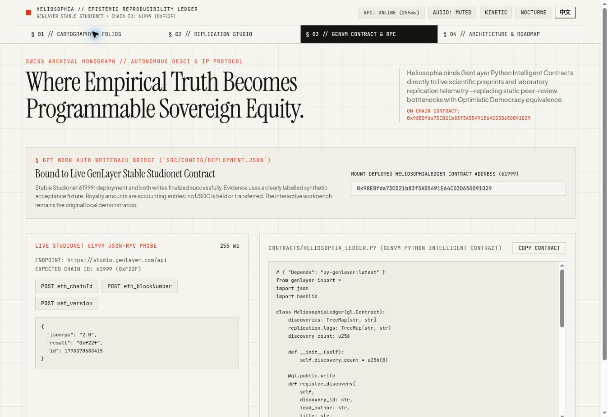
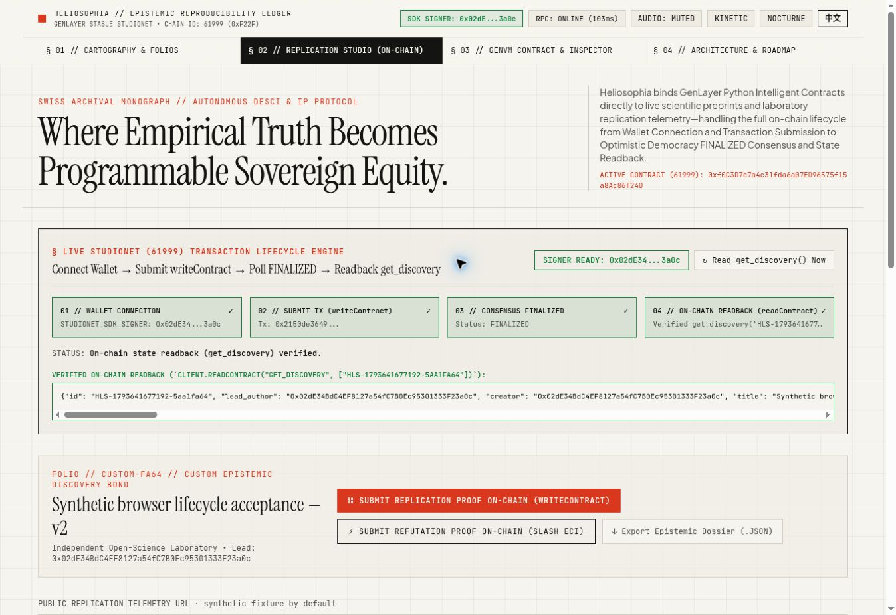

# Verification

## Deterministic tests

`python3 contracts/test_heliosophia_contract.py` imports the production contract and runs 14 tests using mocked GenVM I/O and storage. Coverage includes source commitment, baseline synthesis, successful and refuted evidence, partial evidence, duplicate IDs, repeated content under a different URL, bounded cumulative accounting, malformed model decisions, HTTP errors, input bounds, and view methods.

These tests do not claim to run a real GenVM or establish validator agreement. Live execution is verified separately through finalized successful receipts and contract reads.

## Receipt checks

`node --test scripts/test_studionet_receipt.mjs` runs 7 receipt regression tests. Successful execution, finality, and validator majority agreement are checked separately. An idle validator cannot replace a successful leader, and a finalized transaction without quorum agreement cannot pass verification.

## Frontend preservation

`frontend-integrity.json` records the reviewed v2 frontend baseline. The uploaded source checksums are retained in `docs/evidence/frontend-v2-upload-sha256.json`. Seven frontend files are unchanged byte-for-byte from the v2 ZIP, including CSS, Canvas, sound, architecture, sample data, types and entry point. The four integration files contain targeted functional fixes and one matching telemetry URL input; the deployment configuration contains verified chain data. No visual component, theme, animation or sound engine was removed or replaced. The original `npm run build` command remains unchanged.

## Live integration

`npm run deploy:studionet` verifies deployment, registration, replication, readback, evidence digests, count, and accounting split on Stable Studionet 61999. Finalized transaction summaries and results are written to `onchain-deployment-proof.json`. The deployment configuration remains in local demonstration mode until the entire sequence passes.

The public evidence is a controlled synthetic fixture. Its purpose is to verify real web retrieval and multi-validator contract execution, not to establish a real scientific result. Accounting amounts do not represent token transfers.

## Publication

The GitHub Actions workflow repeats production-source unit tests, checks frontend preservation, executes `npm run build`, and publishes the complete static output to GitHub Pages. Internal handoff files, dependencies, local environments, and private keys are excluded from publication.

## Archived v1 Studionet record — 2026-10-30

Contract: `0x98E0fda73CD21b83f3A55491E64C03D650091029`. Chain ID: **61999**. Gas price: **0**.

Deployment, registration, and replication each reached `FINALIZED`, returned successfully, and recorded three agreeing votes out of five selected nodes. Two idle nodes were excluded after quorum; their cancellation does not replace the leader execution result.

| Operation | Transaction hash |
| --- | --- |
| deployContract | `0x4a3d7304125fde7aa50abed56098d48f303b5d2e9320c8f20f14aa0d928d8e2a` |
| registerDiscovery | `0x9ccfd4e292701dd1e3124d734b76f62b0793a988421c9b070b5816314d4cb75b` |
| submitReplicationProof | `0x5acb862b045765a35498f1d712bdca71c279abae0ff44ad5c0756cb65fea686f` |

Readback: `get_discovery_count() = 1`; `replication_count = 1`; `status = REPLICATED_VERIFIED`; ECI **9550 bps**; accounting allocations **64000 / 16000**. Source and telemetry SHA-256 values match the committed fixtures.

The [archived v1 proof](evidence/studionet-v1-verified.json) includes receipts, votes, source hash, baseline, final state, audit, and the zero-gas RPC check. The initial inconclusive attempt is retained in [its separate evidence record](evidence/studionet-attempt-1.json) and is excluded from the successful proof.

The inputs are labelled synthetic fixtures. These results verify execution of the reported-measurement comparison and accounting policy, not a real scientific experiment, laboratory independence, or a USDC transfer.

The [published build](https://github.com/gqzy1/heliosophia-genlayer-protocol/actions/runs/41072038898) passed all checks and deployed successfully. The public page was checked for the mounted contract address and a live `eth_chainId` response of `0xf22f`.

## v2 browser integration

The uploaded v2 presentation is retained. Functional corrections connect the injected provider, prevent stale signer selection, reject wrong networks and nonzero gas, require successful finalized majority execution, and verify returned discovery identity and inputs. Browser deployment uses the canonical tested contract instead of a stale embedded source. Registration is added to the local selection only after confirmed readback. Pending write buttons prevent duplicate clicks. A public telemetry URL field supports real replication inputs. The original illustrative instrument remains labelled separately from authoritative live JSON.

Eight browser-boundary regression tests cover provider routing, rejected switches, wrong chain, read-only access, ACCEPTED rejection, failed execution, readback mismatch and successful lifecycle. These mocks complement the real chain evidence; they do not prove wallet extension signing.

New v2 deployment: `0xf0C3D7e7a4c31fda6a07ED96575f15a8Ac86f240`. All deployment, registration and replication receipts are finalized successfully with majority agreement; see the current root proof. Previous verified v1 evidence is archived separately.

## Verified browser lifecycle

The browser UI connected a generated SDK signer, registered `HLS-1793641677192-5aa1fa64`, waited for successful FINALIZED majority execution and verified its baseline readback. The same UI then submitted the public synthetic replication telemetry and verified FINALIZED execution and readback: `REPLICATED_VERIFIED`, 9550 ECI basis points, replication count 1, and 48000 / 12000 accounting units. An independent read from the published GitHub Pages inspector returned the same state; the ledger contained two discoveries.

[Browser transaction proof](evidence/browser-lifecycle-v2.json) · [Exported application dossier](evidence/browser-dossier-v2.json) · [Published workflow](https://github.com/gqzy1/heliosophia-genlayer-protocol/actions/runs/41494795824)

This real write-path test used the SDK signer from the managed preview. The identical published build was checked for independent live readback. MetaMask's extension signing was not manually exercised; its provider and network routing are covered by regression tests. All acceptance measurements are synthetic, and royalty figures are ledger accounting only.

