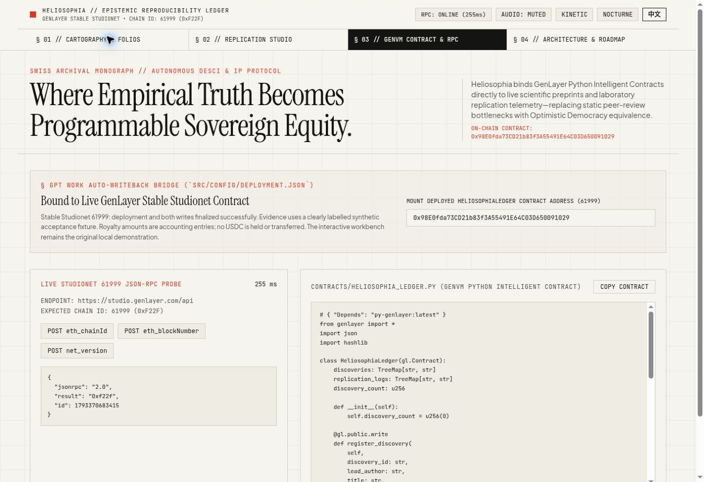

# Verification

## Deterministic tests

`python3 contracts/test_heliosophia_contract.py` imports the production contract and runs 14 tests using mocked GenVM I/O and storage. Coverage includes source commitment, baseline synthesis, successful and refuted evidence, partial evidence, duplicate IDs, repeated content under a different URL, bounded cumulative accounting, malformed model decisions, HTTP errors, input bounds, and view methods.

These tests do not claim to run a real GenVM or establish validator agreement. Live execution is verified separately through finalized successful receipts and contract reads.

## Receipt checks

`node --test scripts/test_studionet_receipt.mjs` runs 7 receipt regression tests. Successful execution, finality, and validator majority agreement are checked separately. An idle validator cannot replace a successful leader, and a finalized transaction without quorum agreement cannot pass verification.

## Frontend preservation

`frontend-integrity.json` records SHA-256 values from the original source package. `node scripts/verify_frontend_integrity.mjs` requires the original file set and exact bytes for all 11 protected frontend files. Only `src/config/deployment.json` may change to contain verified deployment data. The original `npm run build` command is used unchanged.

## Live integration

`npm run deploy:studionet` verifies deployment, registration, replication, readback, evidence digests, count, and accounting split on Stable Studionet 61999. Finalized transaction summaries and results are written to `onchain-deployment-proof.json`. The deployment configuration remains in local demonstration mode until the entire sequence passes.

The public evidence is a controlled synthetic fixture. Its purpose is to verify real web retrieval and multi-validator contract execution, not to establish a real scientific result. Accounting amounts do not represent token transfers.

## Publication

The GitHub Actions workflow repeats production-source unit tests, checks frontend preservation, executes `npm run build`, and publishes the complete static output to GitHub Pages. Internal handoff files, dependencies, local environments, and private keys are excluded from publication.

## Verified Studionet record — 2026-10-30

Contract: `0x98E0fda73CD21b83f3A55491E64C03D650091029`. Chain ID: **61999**. Gas price: **0**.

Deployment, registration, and replication each reached `FINALIZED`, returned successfully, and recorded three agreeing votes out of five selected nodes. Two idle nodes were excluded after quorum; their cancellation does not replace the leader execution result.

| Operation | Transaction hash |
| --- | --- |
| deployContract | `0x4a3d7304125fde7aa50abed56098d48f303b5d2e9320c8f20f14aa0d928d8e2a` |
| registerDiscovery | `0x9ccfd4e292701dd1e3124d734b76f62b0793a988421c9b070b5816314d4cb75b` |
| submitReplicationProof | `0x5acb862b045765a35498f1d712bdca71c279abae0ff44ad5c0756cb65fea686f` |

Readback: `get_discovery_count() = 1`; `replication_count = 1`; `status = REPLICATED_VERIFIED`; ECI **9550 bps**; accounting allocations **64000 / 16000**. Source and telemetry SHA-256 values match the committed fixtures.

The [machine-readable proof](../onchain-deployment-proof.json) includes receipts, votes, source hash, baseline, final state, audit, and the zero-gas RPC check. The initial inconclusive attempt is retained in [its separate evidence record](evidence/studionet-attempt-1.json) and is excluded from the successful proof.

The inputs are labelled synthetic fixtures. These results verify execution of the reported-measurement comparison and accounting policy, not a real scientific experiment, laboratory independence, or a USDC transfer.

The [published build](https://github.com/gqzy1/heliosophia-genlayer-protocol/actions/runs/41072038898) passed all checks and deployed successfully. The public page was checked for the mounted contract address and a live `eth_chainId` response of `0xf22f`.

